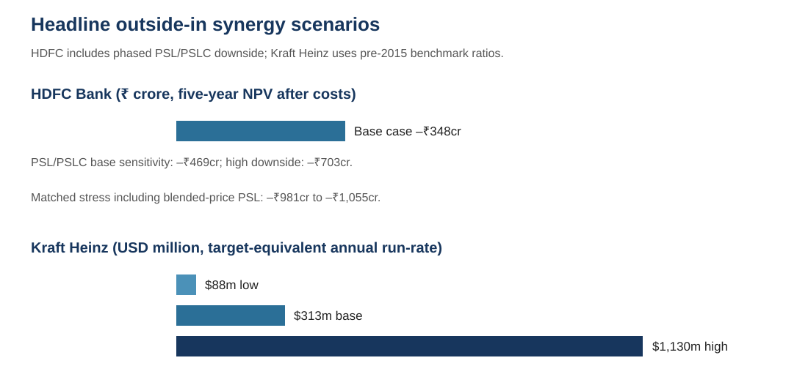

# AI-Assisted M&A Synergy & Due Diligence Analyzer

An evidence-led model of merger synergies, integration costs and post-close financial outcomes, with HDFC Bank–HDFC Ltd and Kraft Heinz as the two quantitative cases.



- **HDFC:** including the new phased PSL/PSLC downside, the base-case five-year after-cost NPV is approximately **–₹261cr**. Matched adverse stress cases including high PSL downside are approximately **–₹2,606cr to –₹2,680cr**. These are analyst sensitivities, not realised savings.
- **Kraft Heinz:** management reported more than **USD 1.7bn cumulative savings** by end-2017 against a USD 1.5bn annual run-rate target, but later impairment charges show that synergy delivery is not the same as value creation.
- **HDFC actuals:** post-merger cost of funds remained around **4.8–4.9%** through FY24/Q1 FY25, CASA fell from **42%** in Jun-23 to **36%** in Jun-24, and the credit-deposit ratio declined from about **110%** at merger to **96%** by Mar-25. These outcomes are consistent with balance-sheet repositioning, but do not isolate the merger's causal funding benefit.

## How to run

```bash
pip install -r requirements.txt
python run.py
```

## Headline cases

| Deal / lever | Low | Base | High | Interpretation |
|---|---:|---:|---:|---|
| HDFC funding substitution — 5-year NPV after costs (₹cr) | +80 | +475 | +1,482 | Funding-spread and migration sensitivities |
| HDFC CRR/SLR reserve drag — 5-year NPV (₹cr) | –67 | –228 | –483 | Reserve opportunity-cost sensitivity |
| HDFC legacy operating-cost lever — 5-year NPV after programme costs (₹cr) | –72 | –127 | –157 | Negative in every scenario because programme costs exceed savings |
| HDFC PSL/PSLC compliance cost — 5-year NPV (₹cr) | –4 | –382 | –2,328 | Conservative non-individual loan proxy; phase-in and certificate-price sensitivities |
| Kraft Heinz gross annual run-rate (USD bn) | 0.04 | 0.21 | 0.91 | Pre-2015 benchmark range; target exceeds benchmark high |

**HDFC combined base case:** approximately **–₹261cr** five-year after-cost NPV across the four quantified levers. The PSL base sensitivity contributes approximately **–₹382cr** of that total.  
**HDFC matched adverse stress including high PSL:** approximately **–₹2,680cr** at 30% migration / 80% ramp and **–₹2,606cr** at 20% / 65%. The pre-PSL core stress checks remain **–₹352cr** and **–₹278cr**, respectively. Funding benefit and reserve drag use the same migration share and ramp; the PSL stress uses the high PSLC price and 75% residual shortfall purchase assumption.

**Important estimate caveat:** HDFC's funding spreads, reserve opportunity-cost and PSL/PSLC purchase assumptions are analyst sensitivities, not reported realised savings or a disclosed HDFC shortfall. The PSL proxy excludes all individual loans and uses broad non-individual balances; loan-level eligibility and actual PSLC category mix are unavailable. Kraft Heinz's overlap range is now calibrated to three pre-March-2015 deals; the $1.5bn target equals **6.52%** of the model's $23bn cost-pool proxy, above the benchmark high of **4.91%**.

## Core conclusion

"Synergies were delivered, but value was destroyed anyway" is the key Kraft Heinz lesson. The company reported more than USD 1.7bn cumulative savings by end-2017, but recorded USD 15.936bn of goodwill and intangible impairment in FY18 and a further USD 1.899bn in FY19. These write-downs signal severe value erosion; they do not alone prove that the merger caused all of it.

For HDFC, the model does not apply a generic cost-overlap percentage to the merged bank. It models funding substitution against CRR/SLR reserve carry and now includes a phased PSL/PSLC sensitivity. The PSL estimate is deliberately conservative and should not be read as an observed regulatory shortfall.

## Kraft Heinz pre-2015 benchmark

The benchmark table was committed before changing the Kraft Heinz overlap inputs. It contains three pre-March-2015 food/consumer transactions with disclosed annual cost-synergy targets: Kraft–Cadbury (2010), Kellogg–Pringles (2012) and AB InBev–Anheuser-Busch (2008). Target-to-combined-cost-base ratios are **0.38%**, **1.36%** and **4.91%**; the median is **1.36%**. The Kraft Heinz $1.5bn annual target is **6.52%** of the $23bn model cost-pool proxy and therefore sits **above**, not within, the observed benchmark range. The Pringles cost base is an EBITDA-derived proxy, and the three transactions differ in category and accounting presentation; this is a directional benchmark, not a statistical population.

## Event-study sanity check

The 4 April 2022 HDFC merger announcement produced close-to-close raw returns of **+10.01% for HDFC Bank** and **+9.29% for HDFC Ltd**, according to SEBI's adjudication order. These are not abnormal returns: the Nifty 50 also rose approximately 2.17% that day, according to Reuters. The event-study workflow estimates market-model CAR and t-statistics for the two headline deals where a listed security and usable price history are available; Heinz was private at announcement and therefore has no target-share-price series. For each listed security, the market model uses the 120 to 20 trading-session pre-event estimation window and reports CAR over [-1,+1], [-2,+2] and [-5,+5]. Benchmarks are the S&P 500 for Kraft and Nifty 50 for Indian securities. HDFC Ltd's delisted daily series and KRFT's historical daily feed are not available in the current cache, so their sourced raw-price reactions are shown separately and never labelled CAR.

<!-- EVENT_STUDY_TABLE_START -->
| Deal | Security | [-1,+1] CAR (t) | [-2,+2] CAR (t) | [-5,+5] CAR (t) |
|---|---|---:|---:|---:|
| HDFC | HDFC Bank (acquirer) | +7.03% (t=+4.20) | +4.18% (t=+1.93) | +3.09% (t=+0.93) |
| HDFC | HDFC Ltd (target) | n/a; SEBI reports +9.29% close-to-close on announcement day; raw return, not CAR. | n/a | n/a |
| KRAFT_HEINZ | Kraft Foods Group (listed target) | n/a; SEC S-4 reports USD 61.33 on 24 Mar and USD 89.40 on 9 Apr (+45.8% cumulative); not event-window CAR. | n/a | n/a |
<!-- EVENT_STUDY_TABLE_END -->

[SEBI adjudication order (HDFC announcement-day reaction)](https://www.sebi.gov.in/web/?file=https%3A%2F%2Fwww.sebi.gov.in%2Fsebi_data%2Fattachdocs%2Fjul-2025%2F1753789804303_1.pdf) · [Reuters market close report](https://www.marketscreener.com/quote/stock/HOUSING-AND-DEVELOPMENT-B-6498420/news/Indian-shares-surge-on-HDFC-twins-merger-plan-39956925/)

## Optional: evidence extraction (blocked pending API credits)

The gold set contains 46 manually curated claims across HDFC and Kraft Heinz. The agent is manual-only, filters filing pages by keyword, uses structured JSON-schema outputs and checks every excerpt against the exact cited PDF page.

| Metric | Result |
|---|---:|
| Gold claims | 46 |
| Model-extracted claims | 0 |
| True positives | 0 |
| Precision | undefined |
| Recall | undefined |

Manual extraction workflow run #2 completed, but the OpenAI API returned HTTP 429 because the account had no remaining credits. No claims were extracted, so precision and recall are undefined. Add API credits and rerun before treating the agent as operational. Kraft's SEC S-4 also discloses a move from USD 61.33 on 24 March to USD 89.40 on 9 April 2015 (+45.8% cumulative); this is not a market-adjusted event-window return.

## Run the model and tests

Dependencies are pinned to the direct-package versions installed by the successful Python 3.11 CI run (17 November 2026); transitive packages remain resolver-managed.

    python -m venv .venv
    source .venv/bin/activate
    pip install -r requirements.txt
    python run.py

The unified run validates sources and assumptions, builds the directional low/base/high model, downloads SEC Companyfacts, creates financial diligence tables, refreshes the event study when market data is available, generates the workbook and PowerPoint deck, and runs pytest. If the market-data provider is unavailable and no cache exists, the event study skips safely so pytest still runs.

## Manual refresh workflows

- **Manual evidence extraction:** add OPENAI_API_KEY in GitHub repository secrets, then run Actions → Manual evidence extraction. It commits page chunks, verified claims and precision/recall output.
- **Refresh multi-deal event study:** run Actions → Refresh multi-deal event study. It downloads and commits data/market_prices.csv plus dashboard/event_study_results.csv. The workflow includes Kraft Foods Group/KRFT and HDFC Bank/HDFC Ltd; Heinz is private at announcement. Zomato–Blinkit is retained as a qualitative appendix case.

## Outputs

- output/MA_Synergy_Model.xlsx: editable scenario inputs, directional calculations, five-year NPV, announced-vs-estimated-vs-realised bridge, evidence and financial diligence.
- output/MA_Executive_Deck.pptx: answer-led deck with native PowerPoint scenario, Blinkit EBITDA and HDFC cost-to-income charts, plus Air India/Microsoft appendix slides.
- dashboard/tableau_synergy_data.csv: scenario estimates, signed negative synergies, confidence and assumption provenance.
- dashboard/financial_due_diligence.csv: financial metrics, before/after changes and caveats.
- dashboard/event_study_results.csv: event-window CAR and t-statistics after manual market-data refresh.
- agent/output/: committed only after the manual extraction workflow has produced real output.

## Tableau and Alteryx

The repository contains Tableau-ready data sources and a dashboard specification in dashboard/tableau_spec.md. A Tableau Public workbook has **not** been published from this environment; publishing requires an authenticated Tableau Public session. The Alteryx source-cleaning workflow is in alteryx/source_register_cleaning.yxmd; it has not been executed or screenshot-verified in Alteryx Designer.

## Appendix: qualitative cases

These cases are retained as supporting research, not headline synergy valuations. They are excluded from the headline conclusions because public data does not support comparable, attributable financial synergy estimates.

- **Air India–Vistara:** a qualitative post-merger integration case. Public milestones include vendor-contract consolidation, IT-system alignment and migration activity, but these are integration outputs rather than verified procurement savings or revenue uplift. See `research/deal_briefs/AIR_INDIA_VISTARA.md`.
- **Zomato–Blinkit:** Blinkit's standalone financial trajectory is useful context, while the Zomato acquirer event-study series is a separate market-reaction check. Blinkit was privately held at announcement; neither operating improvement nor the acquirer share-price reaction establishes attributable acquisition synergies.
- **Microsoft–LinkedIn:** a financial trajectory case. LinkedIn's revenue growth is not proof of Microsoft cross-sell attribution. See the deal brief and source material retained in `research/`.

## Evidence and caveats

- data/source_register.csv: source-of-truth register.
- research/evidence_ledger.csv: hand-built evidence claims and attribution caveats.
- agent/gold_claims.csv: 46-claim evaluation set.
- research/financial_due_diligence.csv: HDFC funding mix, standalone cost base, regulatory requirements, Kraft Heinz impairments and segment financial metrics.
- research/integration_risk_register.csv: integration risks and mitigations.
- model/assumptions_register.csv and model/synergy_inputs.csv: analyst assumptions separated from management disclosures.

## Limitations & next steps

- HDFC post-merger actuals are observational. Balance-sheet mix, deposit pricing, interest-rate cycles, growth calibration and the merger all changed; the available disclosures do not isolate a causal synergy effect.

- The HDFC funding, CRR/SLR and PSL/PSLC calculations remain analyst sensitivities. A liability-level NDTL schedule, loan-level PSL classification and actual PSLC purchase mix are required for a bank-grade estimate.

- The three-deal Kraft Heinz benchmark is small and heterogeneous; the Pringles denominator includes an EBITDA-derived cost proxy. Event-study CARs are single-event market-model estimates, not causal proof; data-provider adjustment conventions are selected consistently within each ticker.
- Air India–Vistara, Zomato–Blinkit and Microsoft–LinkedIn are qualitative appendix cases, not fully modelled synergy valuations.
- Tableau Public is not published and the Alteryx workflow has not been executed in Designer; the repository only includes Tableau-ready data/specification and the Alteryx workflow file.
- The evidence-extraction agent has run, but the current run produced no claims because the OpenAI API account had no remaining credits. Precision and recall are therefore undefined.

## Project structure

- agent/: structured extraction, keyword filtering, exact-page quote checks and gold-set evaluation.
- pipeline/: source validation, financial analysis, SEC XBRL, event study, synergy model and artifact generation.
- research/: deal briefs, evidence ledger, financial diligence, announced targets and risk register.
- model/: directional low/base/high inputs and five-year NPV assumptions.
- dashboard/: Tableau-ready outputs and specifications.
- alteryx/: source-register cleaning workflow.
- tests/: model, agent and event-study tests.
